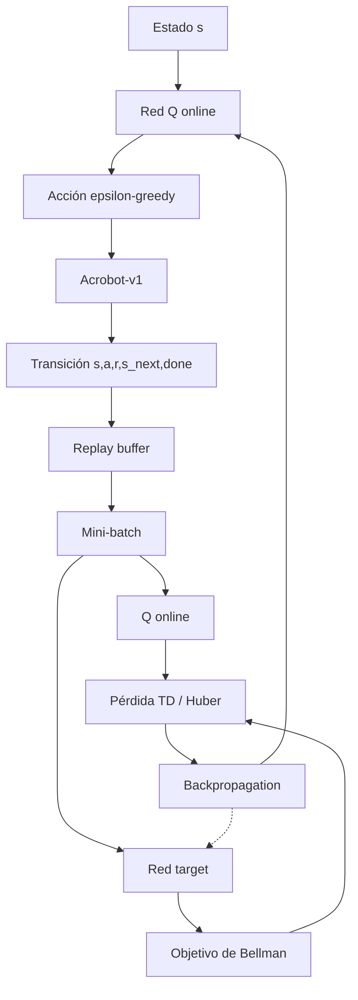
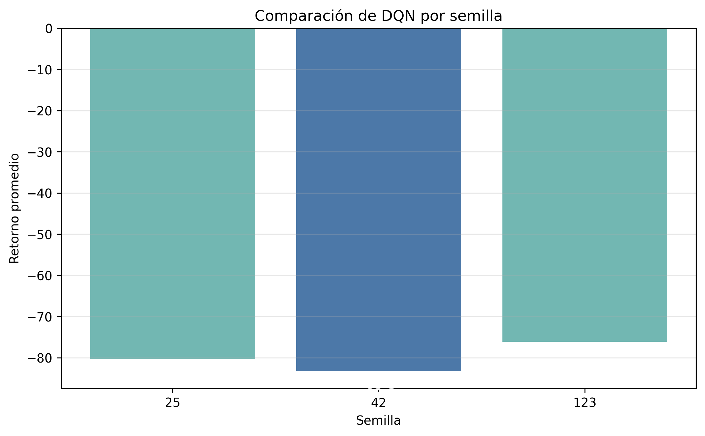

# Taller 2 — DQN sobre Acrobot-v1

## Presentado por

- Ernesto Ilich Contreras Hernandez.
- Jesus Gabriel Castillo Malaver.
- Noel Eduardo Perez Barrios.
- Paola Andrea Roa Molina.
- Ruslan Valery Yaya Chujmanov.
- Victor Enrique Cantor Beltran.

## Resultados principales

| | Política aleatoria | DQN (semilla 42) | DQN (promedio 3 semillas) |
|---|---:|---:|---:|
| Retorno promedio | -500.00 | -83.30 | -79.92 |
| Pasos promedio por episodio | 500 | 84.3 | 80.9 |
| Tasa de éxito | 0 % | 100 % | 100 % |

El agente pasa de no resolver nunca el ambiente a resolverlo siempre, en unos 80 pasos. El detalle está en la sección 5.

---

## 1. Descripción del ambiente

### 1.1 Entorno

El ambiente seleccionado es `Acrobot-v1`, un sistema compuesto por dos eslabones articulados. El objetivo consiste en aplicar torque en la articulación para acumular suficiente energía y lograr que el extremo libre alcance la altura objetivo.

El episodio puede finalizar por dos razones:

- **`terminated=True`**: el agente alcanzó la condición objetivo del ambiente.
- **`truncated=True`**: se alcanzó el límite máximo de **500 pasos** sin resolver el episodio.

Esta diferencia es importante para calcular correctamente la tasa de éxito: una truncación no se considera una solución del ambiente.

### 1.2 Espacio de observaciones

El espacio de observación es un `Box` de forma **`(6,)`** y tipo **`float32`**.

| Componente | Significado | Rango aproximado |
|---|---|---:|
| 1 | `cos(theta1)` | [-1, 1] |
| 2 | `sin(theta1)` | [-1, 1] |
| 3 | `cos(theta2)` | [-1, 1] |
| 4 | `sin(theta2)` | [-1, 1] |
| 5 | Velocidad angular de `theta1` | [-12.566, 12.566] |
| 6 | Velocidad angular de `theta2` | [-28.274, 28.274] |

Los límites observados directamente en Gymnasium fueron:

```text
Límite inferior:
[ -1.        -1.        -1.        -1.       -12.566371 -28.274334]

Límite superior:
[ 1.        1.        1.        1.        12.566371  28.274334]
```

La representación mediante seno y coseno evita la discontinuidad que aparecería al representar directamente un ángulo alrededor de ±π.

No se utilizan imágenes como entrada, por lo que **no se requieren convoluciones, apilamiento de frames ni preprocesamiento visual**. Tampoco se aplicó una normalización adicional: el estado ya es un vector numérico de baja dimensión y con rangos conocidos, adecuado para una red multicapa totalmente conectada.

### 1.3 Espacio de acciones

El espacio de acciones es **`Discrete(3)`**:

| Acción | Torque aplicado |
|---:|---:|
| 0 | -1 |
| 1 | 0 |
| 2 | +1 |

El agente no puede elevar directamente el sistema desde cualquier estado. Debe aprender una secuencia de torques que genere oscilaciones y permita acumular energía antes de alcanzar la altura objetivo.

### 1.4 Sistema de recompensas

El ambiente entrega:

- **-1** por cada paso mientras no se alcance la meta.
- **0** cuando se alcanza la condición terminal.

Por esta razón, un retorno **menos negativo representa un mejor desempeño**, ya que significa que el agente necesitó menos pasos para resolver el episodio.

---

## 2. Flujo de entrenamiento DQN



El ciclo implementado sigue la lógica clásica de DQN:

1. La observación actual $s$ ingresa a la red Q online.
2. La acción se selecciona mediante una política **epsilon-greedy**.
3. El agente ejecuta la acción en `Acrobot-v1`.
4. La transición $(s,a,r,s',done)$ se almacena en el **replay buffer**.
5. Se extraen mini-lotes de experiencias para reducir la correlación temporal entre muestras consecutivas.
6. La **red target** se usa para construir un objetivo de aprendizaje más estable.
7. La diferencia entre la predicción de la red online y el objetivo genera la pérdida TD.
8. La red online se actualiza mediante backpropagation.
9. La red target se sincroniza periódicamente con la red online.

### 2.1 Objetivo de Bellman

Para una transición no terminal, el objetivo usado por DQN puede expresarse como:

$$
y = r + \gamma \max_{a'} Q_{target}(s',a')
$$

Cuando el estado siguiente es terminal, no se agrega valor futuro:

$$
y = r
$$

De forma compacta:

$$
y = r + \gamma\,(1-done)\,\max_{a'} Q_{target}(s',a')
$$

La red online aproxima $Q(s,a)$, mientras que la red target proporciona un objetivo temporalmente más estable. Esta separación reduce la inestabilidad que aparecería si la misma red modificara simultáneamente la predicción y el valor objetivo.

### 2.2 Exploración epsilon-greedy

La exploración comienza con:

- `epsilon inicial = 1.0`
- `epsilon final = 0.1`
- `exploration_fraction = 0.12`

Esto significa que durante aproximadamente el **12 % inicial de los 100.000 timesteps**, epsilon disminuye progresivamente desde 1.0 hasta 0.1. Después permanece en 0.1, manteniendo una pequeña proporción de exploración durante el resto del entrenamiento.

En `Acrobot-v1` esta exploración es especialmente relevante, porque una secuencia útil de torques no es evidente al inicio y el agente debe descubrir oscilaciones capaces de acumular energía.

---

## 3. Particularidades del ambiente

Las características del problema influyen directamente en el diseño del agente:

- La observación es continua, pero el espacio de acciones es discreto; por ello DQN es aplicable.
- El estado tiene únicamente seis variables, por lo que una MLP es suficiente y no se justifica una CNN.
- La recompensa es densa pero negativa: cada paso cuesta -1. Por tanto, aprender equivale a minimizar el número de pasos necesarios para alcanzar la meta.
- El agente debe aprender una estrategia no trivial de acumulación de energía mediante oscilaciones.
- El límite de 500 pasos permite distinguir entre episodios resueltos y truncados.
- Una truncación por límite de tiempo **no equivale a un estado terminal del problema**. Conceptualmente, el objetivo de Bellman no debe anular el valor futuro solo porque terminó el tiempo disponible. Stable-Baselines3 contempla esta diferencia mediante el manejo de *timeouts* en el replay buffer (`handle_timeout_termination`), separando truncaciones por límite temporal de terminales reales.
- La exploración es crítica durante las primeras fases porque una política puramente codiciosa puede quedar atrapada en acciones poco útiles.
- El uso del replay buffer permite reutilizar experiencias pasadas y rompe parcialmente la correlación temporal entre transiciones consecutivas.
- La red target estabiliza el objetivo de Bellman al actualizarse con menor frecuencia que la red online.

---

## 4. Red neuronal e hiperparámetros

### 4.1 Arquitectura

La arquitectura empleada es:

**6 entradas → 256 ReLU → 256 ReLU → 3 valores Q**

| Capa | Dimensión | Función |
|---|---:|---|
| Entrada | 6 | Recibe las seis variables del estado |
| Oculta 1 | 256 neuronas | ReLU |
| Oculta 2 | 256 neuronas | ReLU |
| Salida | 3 | Un valor Q por cada acción discreta |

La MLP se seleccionó porque la entrada es un vector numérico compacto. Las dos capas de 256 neuronas aportan capacidad suficiente para aproximar una función Q no lineal sin introducir la complejidad innecesaria de una arquitectura convolucional.

Stable-Baselines3 implementa DQN con optimización por gradiente y una pérdida TD robusta tipo **Smooth L1 (Huber)**, que reduce la sensibilidad a errores TD muy grandes frente a una pérdida cuadrática pura.

Este ambiente no requiere GPU para el alcance del taller. La entrada tiene seis variables, la red es una MLP pequeña y el entrenamiento de 100.000 timesteps es abordable en CPU.

### 4.2 Hiperparámetros

Los valores utilizados son consistentes con una configuración de referencia publicada para DQN en `Acrobot-v1` dentro del ecosistema RL Baselines3 Zoo. En este taller **no se realizó una búsqueda exhaustiva de hiperparámetros**; se empleó dicha configuración como punto de partida y se verificó experimentalmente que converge dentro del pipeline implementado durante 100.000 timesteps.

| Hiperparámetro | Valor | Razón de uso en este experimento |
|---|---:|---|
| Learning rate | 0.00063 | Mantiene actualizaciones suficientemente pequeñas para evitar oscilaciones excesivas en los valores Q, sin volver demasiado lento el aprendizaje |
| Replay buffer | 50.000 | Permite conservar una colección amplia y diversa de transiciones, reduciendo la correlación temporal entre muestras |
| `learning_starts` | 0 | Se conservó como parte de la configuración de referencia; implica comenzar a aprender desde el inicio y se reconoce como una elección agresiva |
| Batch size | 128 | Proporciona un compromiso entre estabilidad de la estimación del gradiente y costo computacional |
| Gamma | 0.99 | Da alta importancia a recompensas futuras, adecuado porque Acrobot requiere acumular energía durante múltiples pasos |
| Target update interval | 250 | Mantiene el objetivo fijo durante intervalos cortos y reduce la inestabilidad producida por objetivos que cambian continuamente |
| Train frequency | 4 | Evita actualizar la red en cada transición y desacopla parcialmente interacción y optimización |
| Gradient steps | -1 | Hace que el número de actualizaciones se adapte a la cantidad de pasos recolectados desde la última fase de entrenamiento |
| Exploration fraction | 0.12 | Concentra la mayor reducción de exploración al comienzo, cuando todavía es necesario descubrir secuencias útiles de torque |
| Epsilon inicial | 1.0 | Garantiza exploración amplia al inicio |
| Epsilon final | 0.1 | Conserva exploración residual para evitar una política completamente codiciosa durante entrenamiento |
| Arquitectura | [256, 256] | Aporta capacidad suficiente para aproximar una función Q no lineal a partir de solo seis variables de entrada |
| Timesteps | 100.000 | Presupuesto de interacción suficiente para observar convergencia práctica en esta ejecución |

Con `train_freq=4` y `gradient_steps=-1`, Stable-Baselines3 realiza, en términos prácticos, un número de pasos de gradiente ligado al número de transiciones recolectadas desde la última actualización.

La semilla utilizada en el experimento fue:

```python
SEED = 42
```

y el modelo DQN fue construido con `seed=SEED`.

---

## 5. Resultados

### 5.1 Curva de aprendizaje


Para describir la curva usamos los datos de `results/dqn_learning_curve.csv`, que tiene los 934 episodios del entrenamiento. Se distinguen cuatro fases:

| Fase | Timesteps | Episodios | Retorno promedio | Episodios resueltos |
|---|---|---:|---:|---:|
| Inicial | 0 a 4.900 | 10 | -487.8 | 10 % |
| Despegue | 4.900 a 12.000 | 35 | -196.7 | 100 % |
| Mejora progresiva | 12.000 a 50.000 | 343 | -110.3 | 99.4 % |
| Meseta | 50.000 a 100.000 | 546 | -90.6 | 100 % |

1. **Inicial:** mientras epsilon está cerca de 1 casi todas las acciones son aleatorias y el agente se queda en -500. El primer episodio resuelto aparece en el timestep **4.879**.
2. **Despegue:** una vez el replay buffer tiene algunos episodios exitosos, la media móvil sube rápido, de -488 a -170. En el timestep 12.000 epsilon llega a su valor final de 0.1.
3. **Mejora progresiva:** la media móvil cruza **-100 por primera vez en el timestep 26.991**, después de 167 episodios. En esta fase todavía hubo dos episodios truncados en -500 (timesteps 28.424 y 36.467).
4. **Meseta:** desde unos 50.000 timesteps no hay más episodios truncados y la media móvil se mueve entre -103 y -80. Termina en **-87.95**.

Hay más episodios en la meseta que en las otras fases porque cada episodio dura menos. También se ve que la segunda mitad del entrenamiento aportó más estabilidad que mejora en el retorno.

La media móvil de 20 episodios representada en la figura confirma visualmente la misma tendencia: una mejora rápida seguida de una meseta relativamente estable. La variabilidad residual es coherente con la exploración epsilon-greedy: aun cuando el agente ya aprendió una estrategia útil, durante entrenamiento mantiene `epsilon=0.1`, por lo que una fracción de las acciones continúa siendo exploratoria.

Estas cifras permiten respaldar cuantitativamente la lectura de la curva en lugar de depender únicamente de una apreciación visual.

### 5.2 Evaluación final


La evaluación final se realizó durante **30 episodios** con la política en modo determinista.

| Métrica | Valor |
|---|---:|
| Retorno promedio | -83.30 |
| Mediana | -77.50 |
| Desviación estándar | 14.03 |
| Retorno mínimo / máximo | -120 / -63 |
| Episodios de más de 100 pasos | 4 de 30 |

La mediana (-77.5) es mejor que el promedio (-83.3). La mayoría de los episodios queda entre -94 y -75, y el promedio baja por unos pocos estados iniciales que al agente le cuestan más (el peor episodio necesitó 121 pasos).

### 5.3 Comparación con baseline


El baseline corresponde a una política aleatoria evaluada durante **50 episodios**. Tanto el baseline como la evaluación del DQN reinician el ambiente con la semilla `42 + episodio`, así que en los primeros 30 episodios ambas políticas parten de los mismos estados iniciales.

| Métrica | Baseline aleatorio | DQN |
|---|---:|---:|
| Episodios evaluados | 50 | 30 |
| Retorno promedio | -500.00 | **-83.30** |
| Desviación estándar | 0.00 | **14.03** |
| Retorno mínimo | -500.00 | **-120.00** |
| Retorno máximo | -500.00 | **-63.00** |
| Longitud promedio | 500.00 | **84.30** |
| Tasa de éxito | 0.0 % | **100.0 %** |

La mejora absoluta del retorno promedio fue de **416.70 puntos**. La longitud promedio del episodio pasó de 500 a 84.30 pasos, lo que representa una reducción del **83.14 %**. Dicho de otra forma, el agente resuelve la tarea casi seis veces más rápido que el límite del episodio.

El baseline aleatorio no logró resolver ninguno de los episodios evaluados, mientras que el DQN alcanzó una tasa de éxito del **100 %** en la evaluación final.

La evaluación determinista también explica por qué el retorno final (-83.30) puede ser mejor que parte de los valores observados durante entrenamiento: en evaluación no se utiliza la exploración epsilon-greedy, por lo que el agente ejecuta directamente las acciones que considera de mayor valor.

La comparación con el baseline también puede leerse en términos de pasos. La política aleatoria llega al límite de **500 pasos** en promedio, mientras que el DQN con la semilla principal necesita **84.30 pasos**. Esa reducción de **415.70 pasos** es coherente con la recompensa del ambiente: cada paso no terminal cuesta -1, así que resolver antes equivale directamente a obtener un retorno menos negativo.

Otro detalle es que el mejor episodio de cada semilla queda entre -62 y -68, y ninguno baja de ahí. Creemos que eso está cerca del mínimo que permite la física del problema: con un torque de solo ±1, el sistema necesita alrededor de 60 pasos para acumular la energía suficiente. Si es así, el margen de mejora que queda sobre el resultado actual es de unos 20 pasos.

### 5.4 Comparación entre semillas

Para revisar si el resultado dependía de una sola inicialización, se repitió el entrenamiento con las mismas condiciones y tres semillas: `42`, `25` y `123`. Cada modelo se evaluó durante 30 episodios deterministas.



| Semilla | Retorno promedio | Desv. estándar | Longitud promedio | Tasa de éxito |
|---:|---:|---:|---:|---:|
| 42 | -83.30 | 14.03 | 84.30 | 100.0 % |
| 25 | -80.33 | 17.78 | 81.33 | 100.0 % |
| 123 | -76.13 | 12.45 | 77.13 | 100.0 % |

El promedio entre semillas fue **-79.92**, con una desviación entre retornos promedio de **3.60**. Las tres semillas resolvieron todos los episodios evaluados. Esto muestra que, bajo estas tres inicializaciones, el agente aprendió políticas estables y con desempeño parecido. Por esa razón, reportar varias semillas da una evaluación más fuerte que depender únicamente de la ejecución con `SEED = 42`.

Con solo tres semillas, el intervalo de confianza del 95 % para el retorno promedio va de **-88.9 a -71.0** (t de Student con 2 grados de libertad). Todo el intervalo está por encima de -100. Si se juntan los 90 episodios de evaluación, la mediana es -76.5 y 82 de los 90 (91 %) se resolvieron en menos de 100 pasos.

La semilla 42, que es la que usamos en el análisis principal, resultó ser la de peor promedio de las tres. Por eso los resultados de las secciones 5.2 y 5.3 son más bien conservadores.

La semilla `25` produjo un retorno promedio cercano al de `42` y `123`. Su retorno mínimo fue **-147**, peor que el mínimo de las otras dos semillas, pero sin episodios truncados. Esto sugiere variación moderada entre inicializaciones, aunque no una caída estructural del método para este conjunto de semillas.

### 5.5 Entrenamiento frente a evaluación

Durante el entrenamiento se mantiene exploración residual (`epsilon_final = 0.1`). Eso significa que una fracción de las acciones sigue siendo aleatoria incluso cuando la red ya aprendió una estrategia útil. Por esa razón, la curva de entrenamiento puede mostrar retornos peores o más variables que la evaluación final.

La evaluación final se ejecuta con `deterministic=True`, sin exploración epsilon-greedy. En ese modo el agente elige la acción con mayor valor Q estimado. Por eso el retorno evaluado puede verse mejor que algunos registros del entrenamiento: mide la política aprendida sin ruido exploratorio.

Se puede medir esa diferencia. Los últimos 100 episodios del entrenamiento promedian -90.71, frente a -83.30 en la evaluación. Unos 7 pasos por episodio es lo que le cuesta al agente seguir explorando con epsilon = 0.1.

---

## 6. Reflexión de resultados

Los resultados evidencian que el agente logró aprender una política claramente superior a la estrategia aleatoria. El cambio desde retornos cercanos a -500 hasta valores alrededor de -90 durante el entrenamiento muestra que el DQN identificó progresivamente secuencias de torques capaces de acumular energía y elevar el extremo del Acrobot en un número mucho menor de pasos.

El comportamiento observado puede conectarse directamente con los mecanismos del algoritmo. El **replay buffer** reduce la dependencia entre muestras consecutivas y permite reutilizar experiencias relevantes. La estrategia **epsilon-greedy** favorece la exploración durante las primeras fases, lo cual es fundamental para descubrir movimientos de oscilación útiles. La **red target** reduce la inestabilidad del aprendizaje al mantener temporalmente fijo el componente utilizado para calcular el objetivo de Bellman.

La evaluación final confirma que el aprendizaje no corresponde únicamente a una mejora anecdótica del entrenamiento: el agente logró un retorno promedio de **-83.30 ± 14.03** y resolvió los **30 de 30 episodios** evaluados, mientras que la política aleatoria obtuvo -500 de retorno promedio y una tasa de éxito del 0 %.

No obstante, existen limitaciones que deben considerarse. El experimento principal se reporta con la semilla `42`, y la comparación adicional con `25` y `123` muestra estabilidad para estas inicializaciones, aunque no garantiza el mismo comportamiento para cualquier semilla. El parámetro `learning_starts=0` hace que el aprendizaje comience con un replay buffer inicialmente pequeño, mientras que mantener epsilon en 0.1 introduce ruido exploratorio durante todo el tramo final de entrenamiento. Finalmente, la recompensa de -1 por paso favorece trayectorias cortas, pero no distingue explícitamente entre estrategias de movimiento de diferente calidad cuando requieren un número similar de pasos.

La comparación de semillas refuerza esta lectura. El promedio agregado mejora claramente al baseline aleatorio y mantiene una tasa de éxito promedio de **100 %** para las semillas `42`, `25` y `123`. Aun así, para afirmar estabilidad del método, no basta con reportar el mejor entrenamiento: conviene revisar varias inicializaciones y observar tanto retorno promedio como tasa de éxito.

### 6.1 Limitaciones metodológicas

- Se usaron **tres semillas** para la comparación. Es mejor que una sola ejecución, pero sigue siendo una muestra pequeña.
- No se hizo una búsqueda exhaustiva de hiperparámetros; se partió de una configuración de referencia.
- La evaluación se hizo en el mismo ambiente `Acrobot-v1`, sin variaciones externas del problema.
- El costo computacional se mantuvo bajo porque la observación es vectorial y la red es pequeña; aun así, repetir entrenamientos por varias semillas aumenta el tiempo total.

---

## 7. Reflexión sobre lo que más costó

Una de las principales dificultades técnicas fue asegurar que la curva de aprendizaje representara únicamente el entrenamiento definitivo. Durante el desarrollo se generaron distintas ejecuciones y registros en la carpeta de monitoreo. Mezclar estos logs podía producir una curva que combinara experimentos diferentes. Para corregirlo se trabajó con el tramo correspondiente al entrenamiento final de **100.000 timesteps**, evitando mezclar pruebas previas.

Otra dificultad fue comprender la diferencia entre `terminated` y `truncated` en Gymnasium. En este ambiente, `terminated=True` indica que la meta fue alcanzada, mientras que `truncated=True` representa que se llegó al límite temporal. Esta distinción fue necesaria para calcular correctamente la tasa de éxito y evitar clasificar una truncación como una solución del problema.

También fue necesario diferenciar conceptualmente los componentes de DQN. El replay buffer no selecciona acciones: almacena experiencias. Epsilon-greedy controla la exploración. La red online aproxima los valores Q y se actualiza por gradiente. La red target proporciona un objetivo más estable para la actualización de Bellman. Comprender estas funciones por separado permitió interpretar correctamente tanto la implementación como la forma de la curva de aprendizaje.

Otra cosa que aprendimos es lo mucho que puede cambiar una corrida a otra. Con la misma configuración, el promedio de evaluación fue -83.30 con la semilla 42 y -76.13 con la 123, y la semilla 25 tuvo un episodio de -147 aunque su promedio fue bueno. Por eso preferimos reportar las tres semillas y no solo la principal. También tuvimos que revisar las cifras del README contra los CSV, porque después de repetir ejecuciones algunos valores habían quedado de corridas anteriores.

Finalmente, la representación del estado también requirió atención. Los ángulos no se entregan directamente, sino mediante seno y coseno, y las dos velocidades angulares tienen rangos distintos. Comprender esta representación fue importante para justificar por qué una MLP puede trabajar directamente con las observaciones sin necesidad de procesamiento visual ni apilamiento de frames.

---

## 8. Reproducibilidad y ejecución

El repositorio incluye un archivo `requirements.txt`. Para instalar las dependencias:

```bash
pip install -r requirements.txt
```

Después, ejecutar:

```text
Taller2_DQN_Acrobot.ipynb
```

de arriba hacia abajo.

La semilla principal utilizada es `SEED = 42`. En el notebook publicado se verifica además que el constructor `DQN(...)` recibe explícitamente `seed=SEED`. El notebook conserva las salidas de ejecución, por lo que los resultados, tablas, arquitectura de la red y gráficas pueden inspeccionarse sin necesidad de repetir inmediatamente el entrenamiento.

Para cargar el modelo entrenado sin repetir el entrenamiento completo, puede usarse:

```python
import gymnasium as gym
from stable_baselines3 import DQN

env = gym.make("Acrobot-v1")
model = DQN.load("models/dqn_acrobot", env=env)

obs, info = env.reset(seed=42)
action, _ = model.predict(obs, deterministic=True)
```

La configuración principal del experimento también queda resumida en `run_config.json`, para facilitar la trazabilidad de semilla, ambiente, arquitectura e hiperparámetros.

Para repetir únicamente la comparación entre semillas, ejecutar:

```bash
python seed_comparison.py
```

Ese script entrena el mismo DQN con las semillas `42`, `25` y `123`, evalúa cada modelo durante 30 episodios y escribe los resultados en `results/seed_comparison/`.

### 8.1 Costo de ejecución

El experimento principal no requiere GPU. En una máquina local con CPU, el entrenamiento de una semilla es abordable porque la observación tiene seis variables y la red es una MLP de dos capas. La comparación entre semillas entrena tres modelos completos, por lo que tarda más que el notebook principal, pero sigue siendo viable sin Colab para este ambiente.


---

## 9. Estructura del repositorio

```text
Taller2_DQN_Acrobot/
├── README.md
├── Taller2_DQN_Acrobot.ipynb
├── requirements.txt
├── seed_comparison.py
├── run_config.json
├── .gitignore
└── results/
    ├── dqn_learning_curve.png
    ├── dqn_evaluation.png
    ├── comparacion_retornos.png
    ├── seed_comparison/
    ├── evaluation_summary.csv
    └── baseline_vs_dqn.csv
```


---

## 10. Archivos de resultados

| Archivo | Contenido | Uso en el análisis |
|---|---|---|
| `results/dqn_learning_curve.png` | Curva de aprendizaje del entrenamiento final | Evidencia la evolución del retorno durante entrenamiento |
| `results/dqn_evaluation.png` | Retornos de evaluación determinista | Muestra el desempeño final episodio por episodio |
| `results/comparacion_retornos.png` | Comparación baseline vs DQN | Contrasta la política aleatoria con el agente entrenado |
| `results/evaluation_summary.csv` | Métricas finales del agente | Respalda retorno promedio, desviación, mínimos, máximos y tasa de éxito |
| `results/baseline_vs_dqn.csv` | Resumen cuantitativo baseline vs DQN | Respalda la comparación principal del README |
| `results/seed_comparison/seed_summary.csv` | Métricas finales por semilla | Permite revisar estabilidad entre inicializaciones |
| `results/seed_comparison/seed_aggregate.csv` | Promedio y variabilidad entre semillas | Resume la robustez del entrenamiento |
| `results/seed_comparison/seed_return_comparison.png` | Retorno promedio por semilla | Visualiza diferencias entre semillas |
| `results/seed_comparison/seed_evaluation_episodes.csv` | Evaluación por episodio y semilla | Permite auditar fallos o truncamientos puntuales |
| `run_config.json` | Ambiente, semilla, arquitectura e hiperparámetros | Deja trazabilidad de la configuración experimental |

---

## 11. Conclusión

El proyecto cumple el objetivo de formular `Acrobot-v1` como un proceso de decisión, entrenar un agente DQN y evaluar su desempeño con métricas reproducibles. Con la semilla principal, el agente pasó de no resolver nunca el ambiente con la política aleatoria a resolver los 30 episodios de evaluación, con un promedio de 84.30 pasos frente a los 500 del baseline. La media móvil del entrenamiento cruzó -100 cerca del timestep 27.000 y el entrenamiento completo tomó menos de tres minutos en CPU.

Al repetir el entrenamiento con las semillas 25 y 123 obtuvimos resultados muy parecidos: las tres resolvieron todos los episodios, con promedios entre -76 y -83. Por eso consideramos que el aprendizaje no depende de una inicialización favorable, aunque con tres semillas el intervalo de confianza todavía es amplio (de -88.9 a -71.0) y valdría la pena repetirlo con más.

En el comportamiento del agente se reconoce el papel de cada componente de DQN. Mientras epsilon estuvo alto el agente se quedó en -500, y en cuanto el replay buffer tuvo los primeros episodios exitosos el retorno mejoró rápido. La red target y el buffer permitieron que esa mejora fuera estable: después de los 50.000 timesteps no hubo más episodios truncados. Al final, la exploración residual de 0.1 explica que la evaluación determinista sea unos 7 pasos mejor que el entrenamiento. También ayudó que el ambiente se preste para DQN: el estado es un vector de seis variables, suficiente para una MLP, y solo hay tres acciones discretas.

---

## 12. Referencias

- Gymnasium — `Acrobot-v1`.
- Mnih, V., et al. (2013). *Playing Atari with Deep Reinforcement Learning*. arXiv:1312.5602.
- Mnih, V., et al. (2015). *Human-level control through deep reinforcement learning*. Nature, 518.
- Sutton, R. y Barto, A. (2018). *Reinforcement Learning: An Introduction* (2.ª ed.). MIT Press.
- Lapan, M. (2024). *Deep Reinforcement Learning Hands-On* (3.ª ed.). Packt.
- Stable-Baselines3 — implementación de DQN.
- RL Baselines3 Zoo — configuraciones e hiperparámetros de referencia para aprendizaje por refuerzo.
