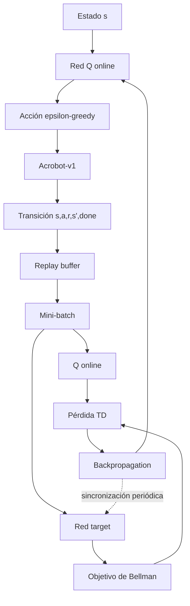
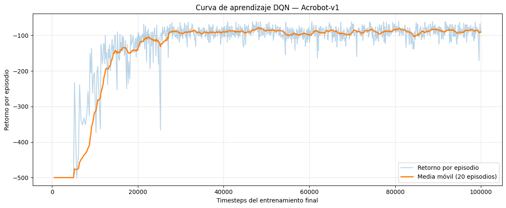
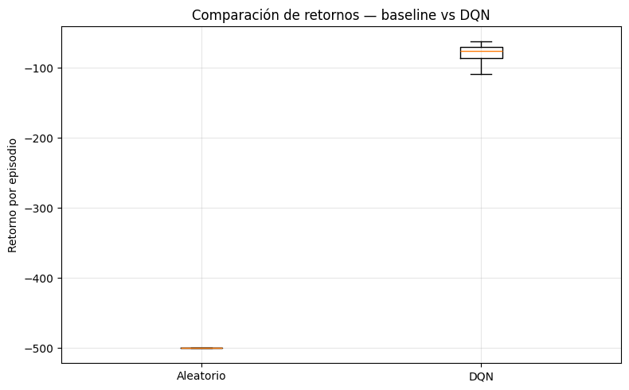
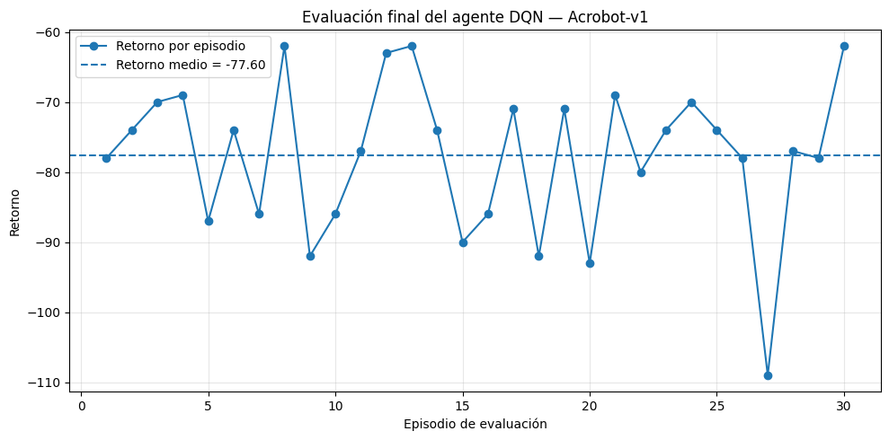

# Taller 2 — DQN sobre Acrobot-v1

## Objetivo
Resolver el ambiente `Acrobot-v1` de Gymnasium mediante un agente Deep Q-Network (DQN), documentando el problema, la arquitectura, el flujo de entrenamiento, los resultados y las principales dificultades.

## Ambiente
- **Entorno:** `Acrobot-v1`
- **Observación:** `Box(6,)`, `float32`
- **Acciones:** `Discrete(3)` con torques -1, 0 y +1
- **Recompensa:** -1 por cada paso no terminal y 0 al alcanzar la meta
- **Límite:** 500 pasos por episodio

No se requiere procesamiento visual ni apilamiento de frames porque el estado ya es un vector numérico continuo.

## Flujo DQN



## Arquitectura e hiperparámetros
**6 → 256 ReLU → 256 ReLU → 3 valores Q**

| Hiperparámetro | Valor |
|---|---:|
| Learning rate | 0.00063 |
| Replay buffer | 50000 |
| Batch size | 128 |
| Gamma | 0.99 |
| Target update interval | 250 |
| Train frequency | 4 |
| Gradient steps | -1 |
| Exploration fraction | 0.12 |
| Epsilon inicial/final | 1.0 / 0.1 |
| Timesteps | 100000 |

## Resultados

### Curva de aprendizaje


### Evaluación final


### Comparación con baseline


| Métrica | Baseline aleatorio | DQN |
|---|---:|---:|
| Retorno promedio | -500.00 | **-77.60** |
| Desviación estándar | 0.00 | **10.92** |
| Longitud promedio | 500.00 | **78.60** |
| Tasa de éxito | 0.0 % | **100.0 %** |

La mejora absoluta del retorno promedio fue de **422.40 puntos** y la longitud media del episodio se redujo aproximadamente **84.28 %** frente al baseline.

## Reflexión de resultados
El baseline aleatorio no resolvió el ambiente. El DQN obtuvo un retorno promedio de **-77.60 ± 10.92** en 30 episodios, con valores entre **-109** y **-62**, longitud promedio de **78.60 pasos** y una tasa de éxito del **100 %**.

La curva muestra una fase inicial inestable y luego una mejora clara hacia retornos menos negativos. En Acrobot esto significa que el agente necesita menos pasos para alcanzar la meta.

## Reflexión sobre lo que más costó
Las mayores dificultades fueron interpretar la representación seno/coseno del estado, comprender el significado de recompensas negativas, diferenciar `replay buffer`, exploración `epsilon-greedy`, red target y actualización de Bellman, y conservar un pipeline reproducible sin mezclar ejecuciones anteriores.

## Reproducibilidad

```bash
pip install -r requirements.txt
```

Después ejecutar `Taller2_DQN_Acrobot.ipynb` de arriba hacia abajo.

## Estructura

```text
Taller2_DQN_Acrobot/
├── README.md
├── Taller2_DQN_Acrobot.ipynb
├── requirements.txt
├── .gitignore
└── results/
    ├── dqn_learning_curve.png
    ├── dqn_evaluation.png
    ├── comparacion_retornos.png
    ├── evaluation_summary.csv
    └── baseline_vs_dqn.csv
```

## Referencias
- Gymnasium — `Acrobot-v1`
- Mnih et al. (2015). *Human-level control through deep reinforcement learning*
- Stable-Baselines3 — DQN
- RL Baselines3 Zoo — hiperparámetros DQN
