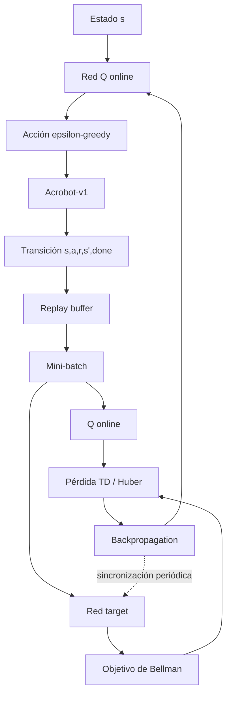

# Taller 2 — DQN sobre Acrobot-v1

## Objetivo

Resolver el ambiente `Acrobot-v1` de Gymnasium mediante un agente **Deep Q-Network (DQN)**, documentando de forma clara el espacio de observaciones y acciones, la lógica de recompensa, el flujo de entrenamiento, la arquitectura de la red neuronal, los hiperparámetros, los resultados obtenidos y las principales limitaciones y dificultades del proceso.

## Presentado por

- Ernesto Ilich Contreras Hernandez.
- Jesus Gabriel Castillo Malaver.
- Noel Eduardo Perez Barrios.
- Paola Andrea Roa Molina.
- Ruslan Valery Yaya Chujmanov.
- Victor Enrique Cantor Beltran.

## 1. Descripción del ambiente

### 1.1 Entorno

El ambiente seleccionado es `Acrobot-v1`, un sistema compuesto por dos eslabones articulados. El objetivo consiste en aplicar torque en la articulación para acumular suficiente energía y lograr que el extremo libre alcance la altura objetivo.

El episodio puede finalizar por dos razones:

- **`terminated=True`**: el agente alcanzó la condición objetivo del ambiente.
- **`truncated=True`**: se alcanzó el límite máximo de **500 pasos** sin resolver el episodio.

Esta diferencia es importante para calcular correctamente la tasa de éxito: una truncación no se considera una solución del ambiente.

### 1.2 Espacio de observaciones

El espacio de observación es un `Box` de forma **`(6,)`** y tipo **`float32`**.

| Componente | Significado | Rango aproximado |
|---|---|---:|
| 1 | `cos(theta1)` | [-1, 1] |
| 2 | `sin(theta1)` | [-1, 1] |
| 3 | `cos(theta2)` | [-1, 1] |
| 4 | `sin(theta2)` | [-1, 1] |
| 5 | Velocidad angular de `theta1` | [-12.566, 12.566] |
| 6 | Velocidad angular de `theta2` | [-28.274, 28.274] |

Los límites observados directamente en Gymnasium fueron:

```text
Límite inferior:
[ -1.        -1.        -1.        -1.       -12.566371 -28.274334]

Límite superior:
[ 1.        1.        1.        1.        12.566371  28.274334]
```

La representación mediante seno y coseno evita la discontinuidad que aparecería al representar directamente un ángulo alrededor de ±π.

No se utilizan imágenes como entrada, por lo que **no se requieren convoluciones, apilamiento de frames ni preprocesamiento visual**. Tampoco se aplicó una normalización adicional: el estado ya es un vector numérico de baja dimensión y con rangos conocidos, adecuado para una red multicapa totalmente conectada.

### 1.3 Espacio de acciones

El espacio de acciones es **`Discrete(3)`**:

| Acción | Torque aplicado |
|---:|---:|
| 0 | -1 |
| 1 | 0 |
| 2 | +1 |

El agente no puede elevar directamente el sistema desde cualquier estado. Debe aprender una secuencia de torques que genere oscilaciones y permita acumular energía antes de alcanzar la altura objetivo.

### 1.4 Sistema de recompensas

El ambiente entrega:

- **-1** por cada paso mientras no se alcance la meta.
- **0** cuando se alcanza la condición terminal.

Por esta razón, un retorno **menos negativo representa un mejor desempeño**, ya que significa que el agente necesitó menos pasos para resolver el episodio.

---

## 2. Flujo de entrenamiento DQN



El ciclo implementado sigue la lógica clásica de DQN:

1. La observación actual \(s\) ingresa a la red Q online.
2. La acción se selecciona mediante una política **epsilon-greedy**.
3. El agente ejecuta la acción en `Acrobot-v1`.
4. La transición \((s,a,r,s',done)\) se almacena en el **replay buffer**.
5. Se extraen mini-lotes de experiencias para reducir la correlación temporal entre muestras consecutivas.
6. La **red target** se usa para construir un objetivo de aprendizaje más estable.
7. La diferencia entre la predicción de la red online y el objetivo genera la pérdida TD.
8. La red online se actualiza mediante backpropagation.
9. La red target se sincroniza periódicamente con la red online.

### 2.1 Objetivo de Bellman

Para una transición no terminal, el objetivo usado por DQN puede expresarse como:

\[
y = r + \gamma \max_{a'} Q_{target}(s',a')
\]

Cuando el estado siguiente es terminal, no se agrega valor futuro:

\[
y = r
\]

De forma compacta:

\[
y = r + \gamma (1-done)\max_{a'}Q_{target}(s',a')
\]

La red online aproxima \(Q(s,a)\), mientras que la red target proporciona un objetivo temporalmente más estable. Esta separación reduce la inestabilidad que aparecería si la misma red modificara simultáneamente la predicción y el valor objetivo.

### 2.2 Exploración epsilon-greedy

La exploración comienza con:

- `epsilon inicial = 1.0`
- `epsilon final = 0.1`
- `exploration_fraction = 0.12`

Esto significa que durante aproximadamente el **12 % inicial de los 100.000 timesteps**, epsilon disminuye progresivamente desde 1.0 hasta 0.1. Después permanece en 0.1, manteniendo una pequeña proporción de exploración durante el resto del entrenamiento.

En `Acrobot-v1` esta exploración es especialmente relevante, porque una secuencia útil de torques no es evidente al inicio y el agente debe descubrir oscilaciones capaces de acumular energía.

---

## 3. Particularidades del ambiente

Las características del problema influyen directamente en el diseño del agente:

- La observación es continua, pero el espacio de acciones es discreto; por ello DQN es aplicable.
- El estado tiene únicamente seis variables, por lo que una MLP es suficiente y no se justifica una CNN.
- La recompensa es densa pero negativa: cada paso cuesta -1. Por tanto, aprender equivale a minimizar el número de pasos necesarios para alcanzar la meta.
- El agente debe aprender una estrategia no trivial de acumulación de energía mediante oscilaciones.
- El límite de 500 pasos permite distinguir entre episodios resueltos y truncados.
- La exploración es crítica durante las primeras fases porque una política puramente codiciosa puede quedar atrapada en acciones poco útiles.
- El uso del replay buffer permite reutilizar experiencias pasadas y rompe parcialmente la correlación temporal entre transiciones consecutivas.
- La red target estabiliza el objetivo de Bellman al actualizarse con menor frecuencia que la red online.

---

## 4. Red neuronal e hiperparámetros

### 4.1 Arquitectura

La arquitectura empleada es:

**6 entradas → 256 ReLU → 256 ReLU → 3 valores Q**

| Capa | Dimensión | Función |
|---|---:|---|
| Entrada | 6 | Recibe las seis variables del estado |
| Oculta 1 | 256 neuronas | ReLU |
| Oculta 2 | 256 neuronas | ReLU |
| Salida | 3 | Un valor Q por cada acción discreta |

La MLP se seleccionó porque la entrada es un vector numérico compacto. Las dos capas de 256 neuronas aportan capacidad suficiente para aproximar una función Q no lineal sin introducir la complejidad innecesaria de una arquitectura convolucional.

Stable-Baselines3 implementa DQN con optimización por gradiente y una pérdida TD robusta tipo **Smooth L1 (Huber)**, que reduce la sensibilidad a errores TD muy grandes frente a una pérdida cuadrática pura.

### 4.2 Hiperparámetros

| Hiperparámetro | Valor | Justificación |
|---|---:|---|
| Learning rate | 0.00063 | Paso de actualización moderado para evitar cambios excesivos en Q |
| Replay buffer | 50.000 | Permite mantener diversidad de experiencias |
| `learning_starts` | 0 | El aprendizaje comienza inmediatamente; se conserva como decisión experimental |
| Batch size | 128 | Proporciona mini-lotes suficientemente estables |
| Gamma | 0.99 | Da alta importancia a recompensas futuras |
| Target update interval | 250 | Actualiza periódicamente la red target |
| Train frequency | 4 | El entrenamiento se activa cada cuatro pasos de interacción |
| Gradient steps | -1 | Realiza tantas actualizaciones como pasos se recolectaron desde la última fase de entrenamiento |
| Exploration fraction | 0.12 | Reduce epsilon durante el 12 % inicial |
| Epsilon inicial | 1.0 | Exploración máxima al inicio |
| Epsilon final | 0.1 | Mantiene exploración residual |
| Arquitectura | [256, 256] | Dos capas ocultas densas |
| Timesteps | 100.000 | Presupuesto total de interacción |

Con `train_freq=4` y `gradient_steps=-1`, Stable-Baselines3 realiza, en términos prácticos, un número de pasos de gradiente ligado al número de transiciones recolectadas desde la última actualización.

La semilla utilizada en el experimento fue:

```python
SEED = 42
```

y el modelo DQN fue construido con `seed=SEED`.

---

## 5. Resultados

### 5.1 Curva de aprendizaje


La curva muestra tres fases principales:

1. **Fase inicial:** durante los primeros miles de pasos el comportamiento es cercano al peor caso del ambiente, con episodios próximos a -500. El agente todavía no dispone de experiencias suficientes para identificar una secuencia útil de torques.
2. **Mejora rápida:** posteriormente el retorno aumenta de manera marcada, indicando que el agente comienza a resolver el entorno en menos pasos.
3. **Meseta:** aproximadamente después de las primeras decenas de miles de timesteps, el retorno se estabiliza alrededor de valores cercanos a -90 durante entrenamiento, aunque permanece una varianza residual.

Esta variabilidad es coherente con la exploración epsilon-greedy: aun cuando el agente ya aprendió una estrategia útil, durante entrenamiento mantiene `epsilon=0.1`, por lo que una fracción de las acciones continúa siendo exploratoria.

### 5.2 Evaluación final


La evaluación final se realizó durante **30 episodios** con la política en modo determinista.

### 5.3 Comparación con baseline


El baseline corresponde a una política aleatoria evaluada durante **50 episodios**.

| Métrica | Baseline aleatorio | DQN |
|---|---:|---:|
| Episodios evaluados | 50 | 30 |
| Retorno promedio | -500.00 | **-77.60** |
| Desviación estándar | 0.00 | **10.92** |
| Retorno mínimo | -500.00 | **-109.00** |
| Retorno máximo | -500.00 | **-62.00** |
| Longitud promedio | 500.00 | **78.60** |
| Tasa de éxito | 0.0 % | **100.0 %** |

La mejora absoluta del retorno promedio fue de **422.40 puntos**. La longitud promedio del episodio pasó de 500 a 78.60 pasos, lo que representa una reducción aproximada del **84.28 %**.

El baseline aleatorio no logró resolver ninguno de los episodios evaluados, mientras que el DQN alcanzó una tasa de éxito del **100 %** en la evaluación final.

La evaluación determinista también explica por qué el retorno final (-77.60) puede ser mejor que parte de los valores observados durante entrenamiento: en evaluación no se utiliza la exploración epsilon-greedy, por lo que el agente ejecuta directamente las acciones que considera de mayor valor.

---

## 6. Reflexión de resultados

Los resultados evidencian que el agente logró aprender una política claramente superior a la estrategia aleatoria. El cambio desde retornos cercanos a -500 hasta valores alrededor de -90 durante el entrenamiento muestra que el DQN identificó progresivamente secuencias de torques capaces de acumular energía y elevar el extremo del Acrobot en un número mucho menor de pasos.

El comportamiento observado puede conectarse directamente con los mecanismos del algoritmo. El **replay buffer** reduce la dependencia entre muestras consecutivas y permite reutilizar experiencias relevantes. La estrategia **epsilon-greedy** favorece la exploración durante las primeras fases, lo cual es fundamental para descubrir movimientos de oscilación útiles. La **red target** reduce la inestabilidad del aprendizaje al mantener temporalmente fijo el componente utilizado para calcular el objetivo de Bellman.

La evaluación final confirma que el aprendizaje no corresponde únicamente a una mejora anecdótica del entrenamiento: el agente logró un retorno promedio de **-77.60 ± 10.92** y resolvió los **30 de 30 episodios** evaluados, mientras que la política aleatoria obtuvo -500 de retorno promedio y una tasa de éxito del 0 %.

No obstante, existen limitaciones que deben considerarse. El experimento principal se realizó con una única semilla (`42`), por lo que no permite afirmar robustez estadística entre distintas inicializaciones. Además, se utilizó DQN estándar; una variante como **Double DQN** permitiría estudiar el posible sesgo de sobreestimación de valores Q. El parámetro `learning_starts=0` hace que el aprendizaje comience con un replay buffer inicialmente pequeño, mientras que mantener epsilon en 0.1 introduce ruido exploratorio durante todo el tramo final de entrenamiento. Finalmente, la recompensa de -1 por paso favorece trayectorias cortas, pero no distingue explícitamente entre estrategias de movimiento de diferente calidad cuando requieren un número similar de pasos.

---

## 7. Reflexión sobre lo que más costó

Una de las principales dificultades técnicas fue asegurar que la curva de aprendizaje representara únicamente el entrenamiento definitivo. Durante el desarrollo se generaron distintas ejecuciones y registros en la carpeta de monitoreo. Mezclar estos logs podía producir una curva que combinara experimentos diferentes. Para corregirlo se trabajó con el tramo correspondiente al entrenamiento final de **100.000 timesteps**, evitando mezclar pruebas previas.

Otra dificultad fue comprender la diferencia entre `terminated` y `truncated` en Gymnasium. En este ambiente, `terminated=True` indica que la meta fue alcanzada, mientras que `truncated=True` representa que se llegó al límite temporal. Esta distinción fue necesaria para calcular correctamente la tasa de éxito y evitar clasificar una truncación como una solución del problema.

También fue necesario diferenciar conceptualmente los componentes de DQN. El replay buffer no selecciona acciones: almacena experiencias. Epsilon-greedy controla la exploración. La red online aproxima los valores Q y se actualiza por gradiente. La red target proporciona un objetivo más estable para la actualización de Bellman. Comprender estas funciones por separado permitió interpretar correctamente tanto la implementación como la forma de la curva de aprendizaje.

Finalmente, la representación del estado también requirió atención. Los ángulos no se entregan directamente, sino mediante seno y coseno, y las dos velocidades angulares tienen rangos distintos. Comprender esta representación fue importante para justificar por qué una MLP puede trabajar directamente con las observaciones sin necesidad de procesamiento visual ni apilamiento de frames.

---

## 8. Reproducibilidad y ejecución

El repositorio incluye un archivo `requirements.txt`. Para instalar las dependencias:

```bash
pip install -r requirements.txt
```

Después, ejecutar:

```text
Taller2_DQN_Acrobot.ipynb
```

de arriba hacia abajo.

La semilla principal utilizada es `SEED = 42`. El notebook publicado conserva las salidas de ejecución para que los resultados, tablas y gráficas puedan inspeccionarse sin necesidad de repetir inmediatamente el entrenamiento.

> Nota de reproducibilidad: para una reproducción bit a bit entre equipos y fechas diferentes es recomendable fijar versiones exactas de todas las dependencias en `requirements.txt`.

---

## 9. Estructura del repositorio

```text
Taller2_DQN_Acrobot/
├── README.md
├── Taller2_DQN_Acrobot.ipynb
├── requirements.txt
├── .gitignore
└── results/
    ├── dqn_learning_curve.png
    ├── dqn_evaluation.png
    ├── comparacion_retornos.png
    ├── evaluation_summary.csv
    └── baseline_vs_dqn.csv
```

Los archivos de resultados se mantienen dentro de `results/`, por lo que las rutas relativas utilizadas en este README funcionan directamente en GitHub.

---

## 10. Archivos de resultados

- `results/dqn_learning_curve.png`: curva de aprendizaje del entrenamiento final.
- `results/dqn_evaluation.png`: retornos obtenidos en la evaluación determinista.
- `results/comparacion_retornos.png`: comparación gráfica entre el baseline aleatorio y DQN.
- `results/evaluation_summary.csv`: métricas finales del agente.
- `results/baseline_vs_dqn.csv`: resumen cuantitativo de la comparación.

---

## 11. Referencias

- Gymnasium — `Acrobot-v1`.
- Mnih, V., et al. (2015). *Human-level control through deep reinforcement learning*. Nature, 518.
- Lapan, M. (2020). *Deep Reinforcement Learning Hands-On* (2.ª ed.). Packt.
- Stable-Baselines3 — implementación de DQN.
- RL Baselines3 Zoo — configuraciones e hiperparámetros de referencia para aprendizaje por refuerzo.
